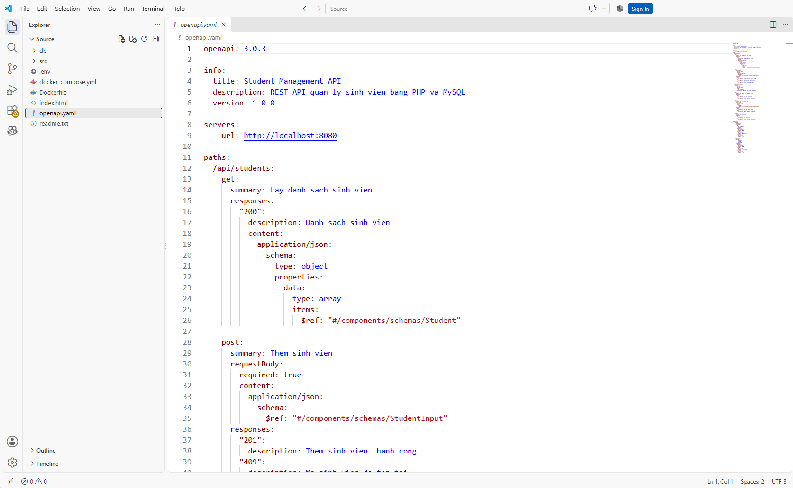

# Nhóm SOA.26-45

**Đề tài:** OpenAPI & Swagger  
**Môn:** Kiến Trúc Hướng Dịch Vụ

**Link:**
- **Git:** (link git)
- **Slides:** https://canva.link/140udzdiprve3ki

## Yêu cầu

- Docker Desktop
- Git

## 1. Tải mã nguồn

Mở CMD và chạy lệnh:

```bash
git clone (link git)
```

Di chuyển vào thư mục mã nguồn vừa tải về.

## 2. Xem tài liệu OpenAPI

Mở file `Source/openapi.yaml`, sao chép toàn bộ nội dung file.



## 3. Sử dụng Swagger Editor

- Truy cập https://editor.swagger.io/
- Thay thế nội dung bên trái bằng nội dung đã sao chép từ `openapi.yaml`.
- Kiểm tra tài liệu API được hiển thị ở bên phải.

## 4. Triển khai Swagger UI bằng Docker

Mở Docker Desktop, sau đó mở PowerShell tại thư mục chứa file `docker-compose.yml` và chạy:

```powershell
docker compose up -d --build
```

## 5. Truy cập Swagger UI

Mở trình duyệt và truy cập:

**http://localhost:8081**

## 6. Generate API Client

Mở PowerShell và chạy:

```powershell
docker run --rm `
  -v "${PWD}:/local" `
  openapitools/openapi-generator-cli generate `
  -i /local/openapi.yaml `
  -g javascript `
  -o /local/generated-client
```

Sau khi hoàn tất, mã nguồn JavaScript Client được tạo trong thư mục `generated-client`.

## 7. Kết thúc

Dừng các container sau khi demo nếu không còn sử dụng:

```powershell
docker compose down
```
